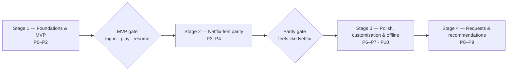
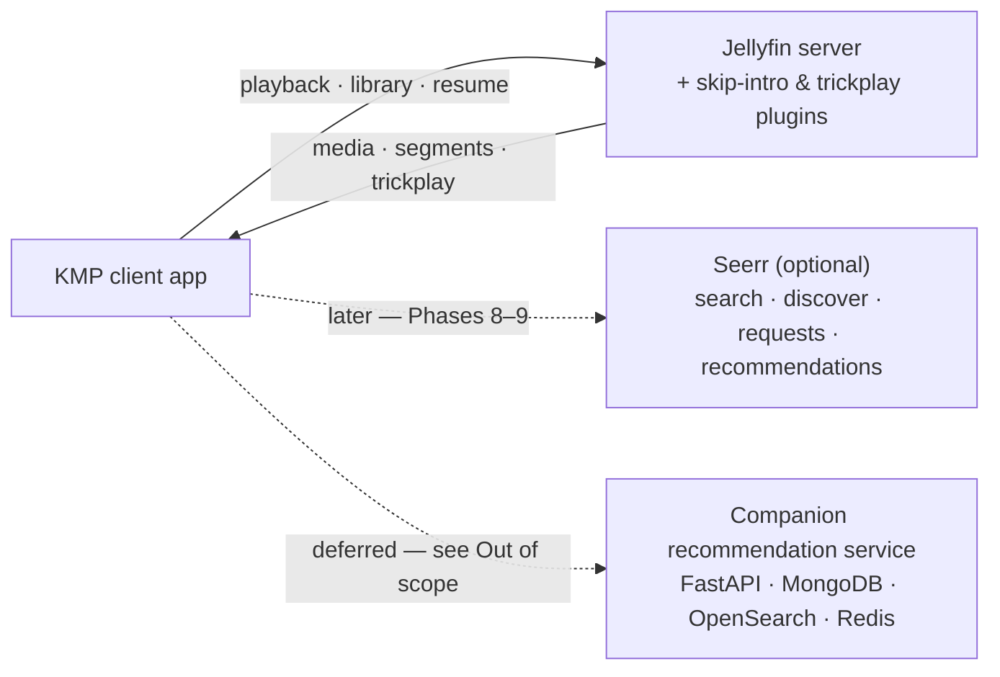

# Jellyfin Client — Roadmap

A custom [Jellyfin](https://jellyfin.org) client aiming for Netflix-grade core UX.
Modern Jellyfin (10.10+) already provides the player and playback machinery; this
roadmap builds a polished client on top of it.

**Guiding principle:** everything mechanical (resume, next up, skip-intro, trickplay,
subtitles, HDR) is server-provided or a thin client layer. The hard, unique work —
personalized discovery — is intentionally **out of scope for now** (see the bottom); a
lighter route to "Because you watched" rows through Seerr is planned in Phase 9.
The account model differs too: Jellyfin has users, not profiles under one account, so
we approximate rather than fight it.

## Stack

- **Kotlin Multiplatform** — shared core in `commonMain` (API client, playback beacon,
  state, offline cache); native UI per platform (or Compose Multiplatform).
- **API layer** — Ktor + kotlinx.serialization in `commonMain`. The official
  [`jellyfin-sdk-kotlin`](https://github.com/jellyfin/jellyfin-sdk-kotlin) is
  JVM/Android-only and [not yet KMP](https://github.com/jellyfin/jellyfin-sdk-kotlin/issues/208),
  so the client is written against the OpenAPI spec at `api.jellyfin.org`.
- **Seerr** — optional, later (Phases 8–9). Same approach as Jellyfin: a thin Ktor client in
  `commonMain`, written against Seerr's own OpenAPI spec (`seerr-api.yml` in
  [`seerr-team/seerr`](https://github.com/seerr-team/seerr), API base path `/api/v1`).
- **Player** — no shared player; behind `expect`/`actual`: Media3/ExoPlayer
  (Android/TV), AVPlayer (iOS/tvOS), VLCJ (desktop).
- **Suggested** — Koin (DI) and SQLDelight (offline/resume cache), both KMP-native.

## Server prerequisites

- **Jellyfin 10.10+** — required for Media Segments and fast Trickplay (10.11 is fine).
- **Plugins** — Intro Skipper or the official Chapter Segments Provider (Jellyfin won't
  detect segments itself); Trickplay enabled per library.
- **Seerr** _(optional, Phases 8–9 only)_ — a [Seerr](https://docs.seerr.dev) instance linked to
  the same Jellyfin server. The app is complete without it; every Seerr feature stays hidden
  until one is connected.

## Milestones

**MVP = Phases 0–2:** log in, browse, play, resume across devices — a usable client on
its own. Treat it as a real release before layering parity and polish.

## Architecture

## Phases

### Phase 0 — Foundations
- [x] Auth: username/password or Quick Connect; store token + stable device id / client name
- [x] Server version & capability check on connect (warn or degrade below 10.10) — _decided: a
  server below 10.10 is rejected, not warned about_
- [x] API client in `commonMain` (base URL, token, retries, error handling)

_Exit: log in, list libraries, fetch an item's metadata._

### Phase 1 — Core playback
- [x] PlaybackInfo negotiation with a device profile (direct play vs HLS transcode)
- [x] Player behind `expect`/`actual` (Media3 / AVPlayer / VLCJ); direct play + transcode fallback — _the
  boundary is the app module: Media3 in `androidApp`, AVPlayer in `iosApp` (plan 03); iOS is written, not built_
- [x] Progress beacon: `POST /Sessions/Playing`, `/Sessions/Playing/Progress` (~10s + pause/seek), `/Sessions/Playing/Stopped` — _`Stopped` on backgrounding and on leaving the screen; after a crash, see Phase 2_
- [x] Audio & subtitle track selection from `MediaStreams` — _in the player where the server sends the track as a file or for a direct play's audio, a new negotiation otherwise (plan 03); iOS burns subtitles in_
- [x] Player failures: a lost connection tries the same stream again twice and then says so, a 401 on the
  stream asks the server once more (which ends the session if the token is dead), anything else falls back
  to one transcode (plan 03)

_Exit: play a movie and an episode, direct and transcoded, with position reported._

### Phase 2 — Watch status & continuity
- [x] `Stopped` after a crash or a killed process (split from Phase 1's progress beacon): keep a pending
  record (item, play session, last position) in Room, keyed by server and profile, and send `Stopped` for
  it on the next start. First item of the Phase 2 plan, so it lands before the MVP gate — _built (plan 06,
  Phase A): the record is dropped after 24 h, and `Stopped` is always sent as the profile that started it_
- [x] Continue Watching, one row that also holds Next Up: `GET /UserItems/Resume` (in progress,
  newest first) followed by `GET /Shows/NextUp` (one episode per series). A series that already has an
  item in progress appears once, as that item. In-progress cards carry the progress bar and Next Up cards
  show their episode ("S2 E5"); tapping either plays. If one request fails the row shows the other, and if
  both fail it shows the row's error state. A plain row above the libraries on the existing Home; Phase 4
  restructures Home around it
- [x] Resume on open (seek to `PlaybackPositionTicks`, 10,000,000 ticks/sec) — _the server's position is
  the source of truth, so there are no per-device positions. Resume is the aqua primary button reading
  "Resume · 38m left", with a round icon-only "start over" arrow beside it and a 5 s rewind when resuming. A local position is
  only the offline fallback (Phase 10)_
- [x] Auto-advance with countdown into Next Up — _owned here: countdown, cancel, on by default. Phase 3
  keeps only "are you still watching?"; Phase 7 makes it a toggle_
- [x] Mark played/unplayed: `POST` / `DELETE /UserPlayedItems/{id}`
- [x] Optimistic user-data writes (played here; favourites in Phase 4; thumbs were cut): the UI changes at once
  and the call follows. If it fails the change reverts with a plain message, and a 401 still ends the
  session. Setting played or a favourite is the one write that is retried (the same retries as
  reads), because setting a state twice is harmless; every other write is still never repeated. Nothing
  is queued on disk until Phase 10

_Exit: finish an episode on one device, resume on another._

### Phase 3 — Player polish
- [x] Playback stats overlay, early in the phase: off by default behind a setting, driven by a shared
  `PlaybackDiagnostics` state that Media3's analytics listener fills on Android and the player item's
  access log fills on iOS. It shows direct play, direct stream or transcode and the transcode reasons the
  server puts in the stream URL, codecs, resolution, frame rate, bitrate, dropped frames, network
  throughput and buffer health. It also makes real-device passes measurable
- [x] Skip Intro / Credits via Media Segments (all types; skip + ask-to-skip)
- [x] Trickplay scrub-preview thumbnails
- [x] HDR / Dolby Vision passthrough where the platform supports it — _Android draws HDR on a `SurfaceView`
  layout and SDR on the `TextureView` one (`player_view_surface.xml`, `player_view_texture.xml`); iOS leaves
  AVPlayer's HDR alone. The choice and playback are verified; **real HDR output is not**, because neither simulator
  reports an HDR display (plan 07)_
- [x] Binge UX: "are you still watching?" (auto-advance itself is Phase 2) — _per-profile setting, Off or after 2 to 5 episodes, default 3_
- [x] Playback speed (Media3 `setPlaybackSpeed`, AVPlayer `rate`)
- [x] Picture-in-picture (both platforms, plus a button in the player). Leaving the player while something plays keeps it playing in
  the system's PiP window (Android: `setAutoEnterEnabled` on 12+ with the Media3 `PlayerSurface`; iOS:
  `AVPictureInPictureController` on the `AVPlayerLayer`). Entering PiP is not backgrounding: the
  progress beacon keeps running and `Stopped` goes out only when the PiP window is closed or playback
  ends (Phase 1 sends it on backgrounding today). On iOS the player steps aside when the window
  starts, so the page it was opened from shows, and tapping the window brings it back. **Decided:** no in-app mini player on either platform (it doubled the PiP
  window); PiP is a per-profile setting, on by default (Phase 6), and off means leaving the app pauses.
  Its `MediaSession` drives media keys, the PiP window's controls and a media notification with play and pause (posted
  in-process by Media3's `PlayerNotificationManager` only while the player screen is in front or in a PiP window; in the
  background without PiP the video pauses, the notification goes and play commands are ignored; no service, no lock-screen
  controls). iOS PiP is built but was never seen running (the simulator reports PiP as
  unsupported).
- [x] HDR and format badge on the detail page and in the player, from `MediaStreams`
  (`VideoRangeType`, codec, resolution)

Also built since: skips in a row add up, and the player shows the total ("30s") by the side the video moved, from the
buttons and from a double-tap; on Android that is the platform's own double-tap seek look (a half circle, running chevrons)
and the skip arrows turn on a press. Android built; iOS Kotlin compiled, Swift not built.

_Exit: skip-intro and scrub previews working end to end._

### Phase 4 — Browse & discovery
_Starts after the state audit (see Cross-cutting)._

- [x] Main navigation bar (Android built and run; iOS written and only parsed; plan 09). Home, Search, Library and Downloads, as drawn in the design's detail screens
  and `BottomNav` (iOS `TabView`, the floating Liquid Glass bar on iOS 26+; Android M3 `NavigationBar`; at
  tablet widths the same destinations sit at the top, `docs/design/screens.md` "Chrome"). Each tab keeps its
  own back stack and Settings stays under the profile avatar. Home is the Home that exists today. Library is the real Library
  browse (below); Downloads opens an empty page that says "Not available yet" (text in `Strings`) until offline lands (Phase 10).
  The Search tab is second, with unified search below.
- [x] Home rows: Latest, genres, My Media, plus Continue Watching (which holds Next Up). Recently added in each video
  library (`GET /Items/Latest`, 20 posters), every genre (biggest first), then My media as 16:9 tiles; each row loads and
  fails on its own, an empty row is not shown, a header has "See all", and there is no cap on rows. Android run on the emulator, iOS
  only parsed. Plan 10
- [x] Home category buttons (Android built and run; iOS parsed; plans 09 and 13) under the header, Netflix-style, as one horizontally scrolling row in this
  fixed order (configurable in Phase 7): **Shows**, **Movies**, **New**, **Categories**. Home itself is never
  filtered; every button opens a page of its own, titled with its name:
  - **Shows**, **Movies** and **New** open that page at once. New is what was added to the server most recently,
    newest first, movies and shows together (`GET /Items` sorted by `DateCreated`, descending)
  - **Categories** carries a chevron and opens a sheet of genres, the player's picker component (`GET /Genres`); the genre picked, such as
    "Action", opens a page with that name and its media (`GET /Items?GenreIds=`)
  - a page is a grid of posters like a folder's list, paged, with the five states; Home's Continue watching and
    libraries are untouched. A page has Sort (name, recently added, rating) and Genre buttons that open the
    player's picker sheet, and keeps its place when you come back from an item. The Categories sheet shows how many
    titles each genre holds. *Built since:* the buttons are filled, with no outline; New and My List pages also have Movies and
    Shows buttons that narrow the list and the genre counts; My List counts its genres from the list, not the library
- [x] Detail page (Android built and run; iOS written and only parsed): metadata, cast, `/Items/{id}/Similar`, collections, extras; plan 11. Under Play four equal actions: My List (heart), Trailer and Watched (tick); Download is hidden until offline lands (Phase 10, plan 14); only the `Strings.download` text and comments are left. The phone's picture is pinned and darkens as the page scrolls over it. On tablets and unfolded foldables a 16:9 backdrop with the details in a left column. The page opens on a full-width cinematic
  backdrop hero (`Backdrop` image) with a dark gradient overlay (the `scrim` token), and the movie
  details and action buttons are layered over the image: the `Logo` image as the title (the
  `brand-display` title when there is none), the facts line (year, rating, runtime, genres), the
  overview, then the actions, with Play / Resume as the one aqua primary button. Cast and similar
  items scroll below the hero. The bar over the hero is transparent (Android) or an inline title
  over the backdrop (iOS); text over the image always sits on the scrim
- [x] Series detail page (Android built and run; iOS parsed): the same hero, then episode cards with all their text on the still (tag, title, synopsis, length, rating, air date; long press: View episode, watched mark), mark the whole series watched, Play holds its place while loading, a season slides in from the side it is on, and the row opens at the current episode. Before: a row of season buttons (about four visible at a time,
  scrolling sideways when there are more), similar to the Nuvio player. The selected season is
  marked and its episodes list below (`GET /Shows/{id}/Seasons`, `GET /Shows/{id}/Episodes?seasonId=`);
  picking another button swaps the list in place. The row opens on the season of the episode Play /
  Resume will start, and Play / Resume on the hero starts that episode
- [x] Unified search (Android built and run, iOS parsed; plan 13): `/Search/Hints` on one screen, with filter buttons (All, Movies, Shows, Episodes, People, Collections), results grouped into Movies, Shows, Episodes,
  People and Collections, and a per-profile history kept on the device; a person opens their page. Seerr adds a "not in your library" section in Phase 8
- [x] Person page (Android built, iOS parsed; plan 12): the biography (`Overview`, when the server's metadata providers supply one) and what
  they appear in within the library (`GET /Items?PersonIds=`); cast on the detail page opens it
- [x] Special features (behind the scenes, extras; plan 12; Android built, iOS parsed) on the detail page (`GET /Items/{id}/SpecialFeatures`)
- [x] Library browse (Android built and run; iOS written and only parsed): the Library tab is every movie and show as a poster grid (three across on a phone) with the title count under its name, and buttons for Movies, Shows, Collections, Sort, Genre, Year (by decade), People (searched by name) and Clear. Changing a filter keeps the old list dimmed and the count in place until the new list is in, so nothing jumps. Sheets show the chosen row as a soft pill, not a tick
- [x] Shared-element transition: built, **off by default** on both platforms (`SHARED_POSTER_ENABLED` on Android, `sharedPosterEnabled` on iOS). Compose's shared transition on Android (no new dependency, seen on the emulator with animations slowed) and iOS 18's zoom navigation transition behind `#available` (written and only parsed). Detail pages open the way the reference video does instead: the screen dims, a skeleton shows, the page fades up whole
- [x] Home hero (Android built and run; iOS written and only parsed): one featured item per session (random among recently added and My List that have a Backdrop and a Logo, never one already watched), a rounded banner card (4:3 on a phone, 2.6:1 from 600dp) with the Logo, a line of what it is and its genres, and Play beside My List (a heart, filled when on the list; a movie plays; a show plays its next episode, else the first episode that is not in Specials, else opens its page), tapping the picture opens its page; a per-profile setting ("Featured titles on Home", Off or 1 to 5) sets how many; from two it is a carousel with page dots that moves on by itself every 8 s and goes round, swipes round too, and opens the poster menu on a long press (plan 19, #17). It sits under the category buttons and above Continue watching. Play is the one aqua button. Optional by design, so Home looks right without it (no item qualifies, or a failure). Its skeleton is in the first frame: Home waits for the setting before drawing
- [x] My List (Favorites): Home row, "See all" page, the detail page's heart, Android built and iOS parsed.
- ~~Thumbs (`UserData.likes`)~~ — _cut:_ Jellyfin's like flag is barely used by its own clients and My List already covers "I want this". Revisit only if Phase 7's recommendations need a signal
- [x] Tile trailers (Android built and run; iOS written and only parsed): a long press on any poster opens a menu with Details, Trailer (only when the title has one, found when the menu opens because lists do not carry trailers: one the server holds plays in the app, one on the web opens in the system's viewer) and My List. The detail page has the same Trailer button

Also built in this phase, not on the original list: Home shows a row for every genre with a per-profile setting to limit them, collections open on their own page with a tablet view, the player uses the whole screen
including the camera cut-out, and a `benchmark` build type (`./gradlew :androidApp:installBenchmark`) for judging smoothness, as the
debug build is slow. Cut: thumbs. A baseline profile for first-scroll speed moves to Phase 6 (it needs Macrobenchmark, which is not in the stack yet: ask first).

Owed after Phase 4: the phone pass and an iOS Xcode pass, its own task: build `iosApp` in Xcode and fix what the compiler finds (every Swift file so far is only parsed, and the `Shared` framework names such as `HeroNavPlay`, `SeeAllMyList` and `ItemFactsKt.getSeasonLabel` are read from the Kotlin source, not from a built framework).

_Exit: switch tabs with their own back stacks, open the Shows, Movies, New and a genre page from Home,_

### Phase 6 — Accounts & polish
- [x] Profile picker: quick-switch between users, optional PIN (Jellyfin has no sub-profiles). _Decided: a 4-digit
  household lock per profile, a salted hash, independent of kids mode, not security_
- [x] Parental controls / kids mode (per-user rating, blocked tags, access schedules). _Decided: a local kids flag;
  rating, tags and hours are read from the Jellyfin user's policy and shown read-only, the server enforces them_
- [x] New-episode notifications (Next Up / Latest polling or push). _Decided: off by default, background polling
  (WorkManager, `BGAppRefreshTask`), new episodes and new movies, a setting called Notifications_
  - [x] Notifications page (per profile, off by default, "Which shows" scope, permission asked when switched on)
  - [x] Polling every profile with Notifications on, at most once per title
  - [x] Android: `WorkManager` check about every 4 h, grouped notifications, tap opens the title (checked on an emulator)
  - [x] iOS: `BGAppRefreshTask` check and local notifications (built as Swift source only, type-checked; not run on a device or simulator)
- [x] Settings: quality & bandwidth, subtitle styling
  - [x] Settings redesign (design system `SettingsPhone`, `SettingsTablet`): a grouped root and a sub-page per
    category (Quality, Subtitles, Skipping and autoplay), choices as menus, Quality as an inline checklist
  - [x] Profile page with Switch profile and Sign out (clears the token, the tile stays locked)
  - [x] Tablet two-pane Settings: iPad `NavigationSplitView`, Android two columns at 600dp
  - [x] Quality as a per-profile cap, Maximum by default, replacing the fixed 60 Mbps
  - [x] Subtitle style settings, applied on Android; iOS shows them disabled while it burns subtitles in
    (applying a style on iOS needs a spike on a simulator, open)
- [x] Picture in picture as a per-profile setting (Skipping and autoplay page, on by default): off hides the button, stops the automatic
  window and pauses on leaving. On iOS the player steps aside while the window plays; starting another title stops the first one
  (with its `Stopped` report). _Built and unit-tested; the window, the step-aside and the new-playout stop were not seen on a device._
- [ ] Now Playing in Control Center and on the Android notification. Built: iOS remote commands
  (play, pause, skip, scrub), a live card and artwork; Android notification artwork. _Not seen on a device; background playback is out of scope._
- [x] iOS mini player: dropped. PiP steps the player aside and the system window is the only mini view; a setting turns PiP off.
- [ ] Baseline profile for first-scroll speed: the `:benchmark` module, the startup and scroll benchmarks and the profile generator
  are in and build (Macrobenchmark 1.5.0, `androidx.baselineprofile` 1.5.0). **Not run**: it needs a device or emulator signed in on the
  test server. Next: `./gradlew :benchmark:connectedBenchmarkReleaseAndroidTest`, then `./gradlew :androidApp:generateBaselineProfile`,
  commit `baseline-prof.txt` and record the numbers.

Owed from Phase 6, not done: the phone pass, a look at the iOS PiP and Control Center behaviour on a real iPhone (the simulator has no PiP). `scripts/ios-smoke.sh` passes
(3 of 3 UITests on an iPhone 16 simulator, iOS 27.0, after the Kids profile row and first-user tile lookups in the UITest were corrected);
it does not exercise playback, PiP or Control Center.

### Phase 7 — Customisation _(later)_

Make the app the user's own: the Home rows, how cards and the hero look, the theme and the player's
behaviour are all settings, kept per profile, and the designed experience stays the default.
_Depends on Phase 4 (Home rows) and Phase 6 (profiles and the first settings). Seerr rows
(Phases 8–9) register into the same row system when they arrive._

- [ ] Settings foundation: one typed settings model per profile, stored in Room and keyed by profile
  (CLAUDE.md: settings live per profile), with defaults and a schema version so new options migrate
  cleanly. Device-wide options ("Always ask who's watching") stay in DataStore. A native Settings
  screen on each platform, grouped in sections and searchable; every option and every section can
  be reset to its default
- [ ] Custom Home rows: reorder, hide and rename any row. Built-in sources are Continue watching
  (Next up included), Latest per library, My List, genres, collections, hidden gems (unwatched, best rated first)
  and My Media; the user can also define
  a row from a library, genre, collection, tag or person, with filters (unwatched, year, rating)
  and a sort order. A row editor with a live preview
- [ ] Row and card layout, set per row: poster, landscape or thumb artwork; card size; item count
  (default 20) and the "See all" grid density; titles, progress and badges shown or hidden. Hero on
  or off, its source (recently added, favourites or a chosen collection) and its height
- [ ] Theming — _decided: the brand stays dark, with aqua the only primary and progress colour._ Options:
  true-black (AMOLED) or lifted "cinematic dark" backgrounds, corner radius, density and text size.
  Each goes into `docs/design/` and `design/tokens.json` first, so the drift check covers every theme.
  Not offered: a light theme, Android dynamic colour, a free colour picker, custom fonts, and accents
  derived from artwork (artwork stays artwork, never a theme)
- [ ] Navigation: choose and order the tabs, set the start tab, hide libraries
- [ ] Player preferences, extending Phase 6's quality and subtitle settings: seek step (default
  10s), gestures on or off, auto-skip intro and credits (off by default), auto-advance and "are you still
  watching?" on or off, default audio and subtitle language. _Built already (Skipping and autoplay page):
  skip back and forward steps, auto-skip intros and recaps, "Still watching" Off or after 2 to 5 episodes,
  Buffer ahead; default audio and subtitle language and when subtitles show (Audio and subtitles page, kept on the
  Jellyfin account, issue #28). Still to do: gestures, auto-advance off_
- [ ] Motion: looping motion (skeleton shimmer) is off by default and an opt-in
  "Looping motion" setting, and is never on when the system asks for Reduce Motion. One-shot motion (the
  shared-element transition, crossfades) is on and follows the system setting
- [ ] Settings that travel: copy settings from another profile, export and import as a file.
  **Open question:** also sync through Jellyfin's per-client `DisplayPreferences` (`CustomPrefs`)
  so a profile looks the same on every device, or keep everything on the device; check the OpenAPI
  spec before deciding
- [ ] Reconcile `docs/design/guardrails.md`: the row order, the 12-row cap, the one-badge rule and
  the "no rotating hero" rule become defaults rather than limits; decide which stay hard limits
- [ ] Every setting holds up: font scale, contrast and screen-reader labels still work, and hiding
  every row still leaves a usable Home

_Exit: reorder and hide Home rows, add a row from a genre, change how its cards look, see one
setting differ between two profiles on the same device, and reset it all to the defaults._

### Phase 10 — Offline _(built; plan 14. Android built and run on the emulator, iOS compiled to klibs and parsed only; the phone pass is owed)_

Watch without a connection. Numbered 10 so that nothing else is renumbered; it is built in Stage 3,
after Phase 7. _Depends on Phase 2 (watch status, for cleaning up watched downloads) and Phase 6
(profiles, since downloads belong to one profile)._

- [ ] Download an item's original file (`GET /Items/{id}/Download`, which needs the user's download
  permission on the server), with background transfers on each platform and a progress state on the
  item. Moved here from Phase 6 (no DRM in base Jellyfin). **Open question:** quality selection. As far
  as we know Jellyfin has no offline transcode for video, so it only goes in if the OpenAPI spec shows a
  way; check before promising it
- [ ] Offline playback of a download through the same native players, with the file as the stream
- [ ] Offline progress: positions and played marks made offline are kept and synced when the connection
  is back, through the same pending-record table as Phase 2's crash-time `Stopped` recovery (design that
  table for both). The server is the source of truth once online; a local position is only the offline
  fallback
- [ ] Storage management: what is downloaded and how much space it takes, remove one or all, a storage
  limit, and automatic clean-up of watched downloads (a setting, off by default)
- [ ] Offline states: the app opens and browses what is downloaded when the server can't be reached, and
  every screen says so (see Cross-cutting)

_Exit: download an episode on Wi-Fi, switch off the network, watch it, then switch the network on and see
the position and played mark arrive on the server._

### Backlog — Advanced playback _(gated on demand)_

Not scheduled. Each item waits for real demand, and its limit is written down here so that it isn't
promised by accident.

- [ ] Subtitle delay — as far as we know neither Media3 nor AVPlayer has a built-in setting, so it means
  custom rendering; a subtitle burned into the picture (every subtitle on iOS today) can't be delayed
- [ ] Audio sync (audio delay) — the same: no built-in setting in either player
- [ ] Decoder selection — Android only (`MediaCodecSelector`); iOS has no equivalent
- [ ] Software-decode fallback for what the device can't decode — a heavy dependency (and licence) to
  add, and the server's transcode already covers the case

### Phase 8 — Seerr integration _(later)_

Search, discover and request titles that are not in the library yet, from inside the app.
_Depends on Phase 4 (search and detail page)._ First part: connect,
search, request, all in native screens; it settles the sign-in question below.

- [ ] Connect a Seerr instance (base URL, optional, saved per profile): check it with `GET /status`
- [ ] Sign in to Seerr as the Jellyfin user: `POST /auth/jellyfin` sets a `connect.sid` session
  cookie, checked with `GET /auth/me`. **Open question:** passwords are never stored, so when that
  cookie expires the user would be asked again; decide between that and a Seerr API key
  (`X-Api-Key`), and store whichever we keep encrypted in the token vault
- [ ] Search beyond the library: `GET /search?query=`, with results marked in library or not
- [ ] Discover rows: `GET /discover/movies`, `/discover/tv`, `/discover/trending`, `/discover/movies/upcoming`, `/discover/tv/upcoming`
- [ ] Title page for something not in the library (`GET /movie/{id}`, `/tv/{id}`) showing request
  state from `mediaInfo.status`: 1 unknown, 2 pending, 3 processing, 4 partially available,
  5 available, 6 deleted. Teal marks available, as everywhere else
- [ ] Request a movie or a series: `POST /request` (`mediaType`, `mediaId`, `seasons` for TV,
  `is4k`), with a season picker; list the user's requests with `GET /request` and their state
- [ ] Join the two worlds: a Seerr title that is available opens the Jellyfin item, matched by
  TMDB id through the item's `ProviderIds`
- [ ] Failure is local: quota reached, already requested, awaiting approval, or Seerr down each say
  so and never get in the way of browsing or playing from Jellyfin

_Exit: search for a title that isn't in the library, request it, watch its status change, and
open it from the app once it is available._

### Phase 9 — Seerr-based recommendations _(later)_

"Because you watched" rows without a backend of our own: Seerr already knows what is similar and
what is trending, and the app supplies the user's own history. _Depends on Phase 2 (watch status)
and Phase 8 (a connected Seerr)._

- [ ] Pick seeds from the user's recent finished titles, mapped to TMDB ids through `ProviderIds`
- [ ] "Because you watched …" rows from `GET /movie/{id}/recommendations` and
  `/tv/{id}/recommendations`, topped up with `/similar`; no title repeats across rows, and nothing
  the user has already watched or requested
- [ ] Every recommendation is one tap from an action: in the library, it plays or opens in Jellyfin;
  not in it, it can be requested (Phase 8)
- [ ] Trending and genre rows from `GET /discover/trending`, `/discover/movies/genre/{id}` and
  `/discover/tv/genre/{id}`, and the user's Seerr watchlist (`GET /user/{userId}/watchlist`)
- [ ] "Not interested": **open question** whether this can use Seerr's blocklist (`POST /blocklist`,
  which may need extra permissions) or has to be kept on the device
- [ ] Cache the composed rows and refresh in the background (see Cross-cutting)

_Exit: Home shows "Because you watched …" rows built from Seerr, each tile either playable or
requestable._

## Cross-cutting

- **Performance** — cache composed home-screen rows; load progressively.
- **Five states** — every screen has loading, empty, offline, error and locked states, with the copy in
  `Strings` / `LoadMessages`; especially the player and the beacon. Loading is a skeleton, not a spinner
  (`CircularProgressIndicator` / `ProgressView` only in the player, as `android.md` and `ios.md` already
  say). Part of every phase's definition of done.
- **State audit (before Phase 4)** — done on `feature/state-audit`: Home libraries, Item, library lists and
  Who's watching load as skeletons on both platforms (`Skeletons.kt`, `Skeletons.swift`). Spinners stay only
  for an action in progress: buttons, device search, "loading more", the player. Servers and Add server show
  their results as they arrive and have no page-load state. Not seen running on iOS.
- **Optimistic writes** — see Phase 2: every user-data write updates the UI at once and reverts with a
  message if it fails.
- **Seerr is optional** — no Seerr screen, row or setting appears until one is connected, and a Seerr failure only affects its own rows.
- **Observability** — propagate a request / correlation id end to end.
- **Testing** — contract tests against the Jellyfin API; integration tests for the beacon lifecycle.

## Out of scope (for now)

### Phase 5 — Intelligence layer _(deferred)_

Personalized "Because you watched" rows, a ranked home screen, and Top 10 / Trending.
Jellyfin only offers genre and similar-item rows, so this is a separate backend effort
rather than an API call: a companion service (FastAPI + MongoDB, OpenSearch for ranking,
Redis for row caching) fed by the playback beacons. To be built or brought in later.

Phase 9 is the lighter route to similar rows: it borrows Seerr's recommendations rather than
learning from playback. It does not replace this phase, which would add a ranked, personalised home
screen; Phase 9's rows can feed it or stay as its fallback.

Natural-language search ("a slow-burn thriller from the 90s") belongs here too. It needs an LLM or an
embeddings index, so it ships with this backend and not as a call from the app, which would send the
user's library queries to a third party. Until then, the filters in Phase 4 and the row filters in
Phase 7 cover the same ground without one.
