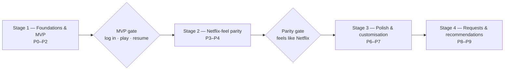
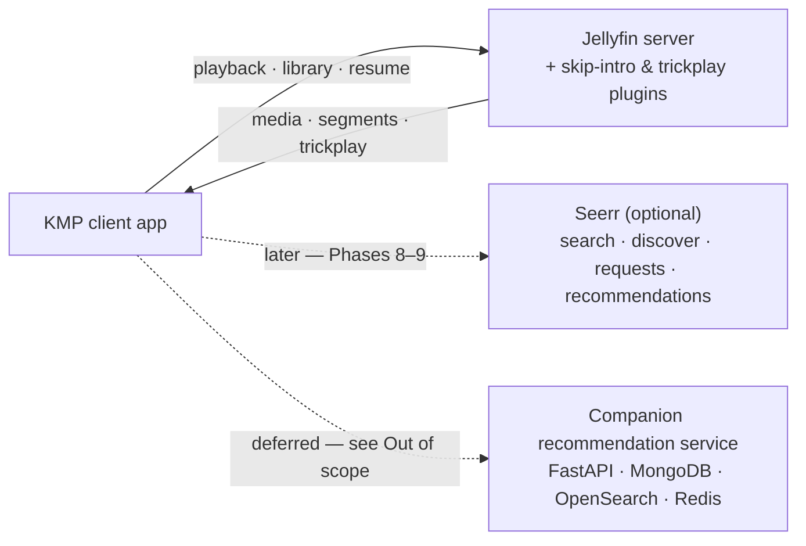

# Jellyfin Client — Roadmap

A custom [Jellyfin](https://jellyfin.org) client aiming for Netflix-grade core UX.
Modern Jellyfin (10.10+) already provides the player and playback machinery; this
roadmap builds a polished client on top of it.

**Guiding principle:** everything mechanical (resume, next up, skip-intro, trickplay,
subtitles, HDR) is server-provided or a thin client layer. The hard, unique work —
personalized discovery — is intentionally **out of scope for now** (see the bottom); a
lighter route to "Because you watched" rows through Seerr is planned in Phase 9.
The account model differs too: Jellyfin has users, not profiles under one account, so
we approximate rather than fight it.

## Stack

- **Kotlin Multiplatform** — shared core in `commonMain` (API client, playback beacon,
  state, offline cache); native UI per platform (or Compose Multiplatform).
- **API layer** — Ktor + kotlinx.serialization in `commonMain`. The official
  [`jellyfin-sdk-kotlin`](https://github.com/jellyfin/jellyfin-sdk-kotlin) is
  JVM/Android-only and [not yet KMP](https://github.com/jellyfin/jellyfin-sdk-kotlin/issues/208),
  so the client is written against the OpenAPI spec at `api.jellyfin.org`.
- **Seerr** — optional, later (Phases 8–9). Same approach as Jellyfin: a thin Ktor client in
  `commonMain`, written against Seerr's own OpenAPI spec (`seerr-api.yml` in
  [`seerr-team/seerr`](https://github.com/seerr-team/seerr), API base path `/api/v1`).
- **Player** — no shared player; behind `expect`/`actual`: Media3/ExoPlayer
  (Android/TV), AVPlayer (iOS/tvOS), VLCJ (desktop).
- **Suggested** — Koin (DI) and SQLDelight (offline/resume cache), both KMP-native.

## Server prerequisites

- **Jellyfin 10.10+** — required for Media Segments and fast Trickplay (10.11 is fine).
- **Plugins** — Intro Skipper or the official Chapter Segments Provider (Jellyfin won't
  detect segments itself); Trickplay enabled per library.
- **Seerr** _(optional, Phases 8–9 only)_ — a [Seerr](https://docs.seerr.dev) instance linked to
  the same Jellyfin server. The app is complete without it; every Seerr feature stays hidden
  until one is connected.

## Milestones

**MVP = Phases 0–2:** log in, browse, play, resume across devices — a usable client on
its own. Treat it as a real release before layering parity and polish.

## Architecture

## Phases

### Phase 0 — Foundations
- [x] Auth: username/password or Quick Connect; store token + stable device id / client name
- [x] Server version & capability check on connect (warn or degrade below 10.10) — _decided: a
  server below 10.10 is rejected, not warned about_
- [x] API client in `commonMain` (base URL, token, retries, error handling)

_Exit: log in, list libraries, fetch an item's metadata._

### Phase 1 — Core playback
- [x] PlaybackInfo negotiation with a device profile (direct play vs HLS transcode)
- [x] Player behind `expect`/`actual` (Media3 / AVPlayer / VLCJ); direct play + transcode fallback — _the
  boundary is the app module: Media3 in `androidApp`, AVPlayer in `iosApp` (plan 03); iOS is written, not built_
- [x] Progress beacon: `POST /Sessions/Playing`, `/Sessions/Playing/Progress` (~10s + pause/seek), `/Sessions/Playing/Stopped` — _`Stopped` on backgrounding and on leaving the screen; after a crash, see Phase 2_
- [x] Audio & subtitle track selection from `MediaStreams` — _in the player where the server sends the track as a file or for a direct play's audio, a new negotiation otherwise (plan 03); iOS burns subtitles in_
- [x] Player failures: a lost connection tries the same stream again twice and then says so, a 401 on the
  stream asks the server once more (which ends the session if the token is dead), anything else falls back
  to one transcode (plan 03)

_Exit: play a movie and an episode, direct and transcoded, with position reported._

### Phase 2 — Watch status & continuity
- [ ] `Stopped` after a crash or a killed process (split from Phase 1's progress beacon): keep a pending
  record (item, play session, last position) in Room, keyed by server and profile, and send `Stopped` for
  it on the next start. First item of the Phase 2 plan, so it lands before the MVP gate
- [ ] Continue Watching: `GET /Users/{id}/Items/Resume` — _plain poster row above the libraries on the
  existing Home; Phase 4 restructures Home around it_
- [ ] Next Up: `GET /Shows/NextUp` — _same: a plain row for now_
- [ ] Resume on open (seek to `PlaybackPositionTicks`, 10,000,000 ticks/sec)
- [ ] Auto-advance with countdown into Next Up — _owned here: countdown, cancel, on by default. Phase 3
  keeps only "are you still watching?"; Phase 7 makes it a toggle_
- [ ] Mark played/unplayed: `POST` / `DELETE /Users/{id}/PlayedItems/{id}`

_Exit: finish an episode on one device, resume on another._

### Phase 3 — Player polish
- [ ] Skip Intro / Credits via Media Segments (all types; skip + ask-to-skip)
- [ ] Trickplay scrub-preview thumbnails
- [ ] HDR / Dolby Vision passthrough where the platform supports it — _the Android player draws on a
  `TextureView` (plan 03), which can't pass HDR through; this means going back to a `SurfaceView` and
  redoing the exit transition (`res/layout/player_view_texture.xml`, `PlayerScreen.kt`)_
- [ ] Binge UX: "are you still watching?" (auto-advance itself is Phase 2)

_Exit: skip-intro and scrub previews working end to end._

### Phase 4 — Browse & discovery
- [ ] Home rows: Latest, genres, My Media, plus Resume & Next Up
- [ ] Detail page: metadata, cast, `/Items/{id}/Similar`. The page opens on a full-width cinematic
  backdrop hero (`Backdrop` image) with a dark gradient overlay (the `scrim` token), and the movie
  details and action buttons are layered over the image: the `Logo` image as the title (the
  `brand-display` title when there is none), the facts line (year, rating, runtime, genres), the
  overview, then the actions, with Play / Resume as the one aqua primary button. Cast and similar
  items scroll below the hero. The bar over the hero is transparent (Android) or an inline title
  over the backdrop (iOS); text over the image always sits on the scrim
- [ ] Series detail page: the same hero, then a row of season buttons (about four visible at a time,
  scrolling sideways when there are more), similar to the Nuvio player. The selected season is
  marked and its episodes list below (`GET /Shows/{id}/Seasons`, `GET /Shows/{id}/Episodes?seasonId=`);
  picking another button swaps the list in place. The row opens on the season of the episode Play /
  Resume will start, and Play / Resume on the hero starts that episode
- [ ] Search: `/Search/Hints`
- [ ] My List (Favorites), thumbs (`UserData.likes`)
- [ ] Tile trailers (`LocalTrailers` / `RemoteTrailers`, content-dependent)

_Exit: browse, search, open a detail page, add to My List._

### Phase 6 — Accounts, offline & polish
- [ ] Profile picker: quick-switch between users, optional PIN (Jellyfin has no sub-profiles)
- [ ] Parental controls / kids mode (per-user rating, blocked tags, access schedules)
- [ ] Offline downloads (no DRM in base Jellyfin)
- [ ] New-episode notifications (Next Up / Latest polling or push)
- [ ] Settings: quality & bandwidth, subtitle styling

### Phase 7 — Customisation _(later)_

Make the app the user's own: the Home rows, how cards and the hero look, the theme and the player's
behaviour are all settings, kept per profile, and the designed experience stays the default.
_Depends on Phase 4 (Home rows) and Phase 6 (profiles and the first settings). Seerr rows
(Phases 8–9) register into the same row system when they arrive._

- [ ] Settings foundation: one typed settings model per profile, stored in Room and keyed by profile
  (CLAUDE.md: settings live per profile), with defaults and a schema version so new options migrate
  cleanly. Device-wide options ("Always ask who's watching") stay in DataStore. A native Settings
  screen on each platform, grouped in sections and searchable; every option and every section can
  be reset to its default
- [ ] Custom Home rows: reorder, hide and rename any row. Built-in sources are Continue watching,
  Next up, Latest per library, My List, genres, collections and My Media; the user can also define
  a row from a library, genre, collection, tag or person, with filters (unwatched, year, rating)
  and a sort order. A row editor with a live preview
- [ ] Row and card layout, set per row: poster, landscape or thumb artwork; card size; item count
  (default 20) and the "See all" grid density; titles, progress and badges shown or hidden. Hero on
  or off, its source (recently added, favourites or a chosen collection) and its height
- [ ] Theming — **open question.** The design language is dark only with one aqua accent for the
  primary action and progress, so what can be themed has to be decided first. Candidates that keep
  the brand: true-black or lifted backgrounds, a curated accent set that passes contrast, corner
  radius, density, text size. Candidates that break it: a light theme, Android dynamic colour, a
  free colour picker. Whatever is chosen goes into `docs/design/` and `design/tokens.json` first,
  so the drift check covers every theme
- [ ] Navigation: choose and order the tabs, set the start tab, hide libraries
- [ ] Player preferences, extending Phase 6's quality and subtitle settings: seek step (default
  10s), gestures on or off, auto-skip intro and credits (off by default), auto-advance and "are you still
  watching?" on or off, default audio and subtitle language
- [ ] Settings that travel: copy settings from another profile, export and import as a file.
  **Open question:** also sync through Jellyfin's per-client `DisplayPreferences` (`CustomPrefs`)
  so a profile looks the same on every device, or keep everything on the device; check the OpenAPI
  spec before deciding
- [ ] Reconcile `docs/design/guardrails.md`: the row order, the 12-row cap, the one-badge rule and
  the "no rotating hero" rule become defaults rather than limits; decide which stay hard limits
- [ ] Every setting holds up: font scale, contrast and screen-reader labels still work, and hiding
  every row still leaves a usable Home

_Exit: reorder and hide Home rows, add a row from a genre, change how its cards look, see one
setting differ between two profiles on the same device, and reset it all to the defaults._

### Phase 8 — Seerr integration _(later)_

Search, discover and request titles that are not in the library yet, from inside the app.
_Depends on Phase 4 (search and detail page)._

- [ ] Connect a Seerr instance (base URL, optional, saved per profile): check it with `GET /status`
- [ ] Sign in to Seerr as the Jellyfin user: `POST /auth/jellyfin` sets a `connect.sid` session
  cookie, checked with `GET /auth/me`. **Open question:** passwords are never stored, so when that
  cookie expires the user would be asked again; decide between that and a Seerr API key
  (`X-Api-Key`), and store whichever we keep encrypted in the token vault
- [ ] Search beyond the library: `GET /search?query=`, with results marked in library or not
- [ ] Discover rows: `GET /discover/movies`, `/discover/tv`, `/discover/trending`, `/discover/movies/upcoming`, `/discover/tv/upcoming`
- [ ] Title page for something not in the library (`GET /movie/{id}`, `/tv/{id}`) showing request
  state from `mediaInfo.status`: 1 unknown, 2 pending, 3 processing, 4 partially available,
  5 available, 6 deleted. Teal marks available, as everywhere else
- [ ] Request a movie or a series: `POST /request` (`mediaType`, `mediaId`, `seasons` for TV,
  `is4k`), with a season picker; list the user's requests with `GET /request` and their state
- [ ] Join the two worlds: a Seerr title that is available opens the Jellyfin item, matched by
  TMDB id through the item's `ProviderIds`
- [ ] Failure is local: quota reached, already requested, awaiting approval, or Seerr down each say
  so and never get in the way of browsing or playing from Jellyfin

_Exit: search for a title that isn't in the library, request it, watch its status change, and
open it from the app once it is available._

### Phase 9 — Seerr-based recommendations _(later)_

"Because you watched" rows without a backend of our own: Seerr already knows what is similar and
what is trending, and the app supplies the user's own history. _Depends on Phase 2 (watch status)
and Phase 8 (a connected Seerr)._

- [ ] Pick seeds from the user's recent finished titles, mapped to TMDB ids through `ProviderIds`
- [ ] "Because you watched …" rows from `GET /movie/{id}/recommendations` and
  `/tv/{id}/recommendations`, topped up with `/similar`; no title repeats across rows, and nothing
  the user has already watched or requested
- [ ] Every recommendation is one tap from an action: in the library, it plays or opens in Jellyfin;
  not in it, it can be requested (Phase 8)
- [ ] Trending and genre rows from `GET /discover/trending`, `/discover/movies/genre/{id}` and
  `/discover/tv/genre/{id}`, and the user's Seerr watchlist (`GET /user/{userId}/watchlist`)
- [ ] "Not interested": **open question** whether this can use Seerr's blocklist (`POST /blocklist`,
  which may need extra permissions) or has to be kept on the device
- [ ] Cache the composed rows and refresh in the background (see Cross-cutting)

_Exit: Home shows "Because you watched …" rows built from Seerr, each tile either playable or
requestable._

## Cross-cutting

- **Performance** — cache composed home-screen rows; load progressively.
- **Resilient states** — loading / empty / offline / error on every screen, especially the player and the beacon.
- **Seerr is optional** — no Seerr screen, row or setting appears until one is connected, and a Seerr failure only affects its own rows.
- **Observability** — propagate a request / correlation id end to end.
- **Testing** — contract tests against the Jellyfin API; integration tests for the beacon lifecycle.

## Out of scope (for now)

### Phase 5 — Intelligence layer _(deferred)_

Personalized "Because you watched" rows, a ranked home screen, and Top 10 / Trending.
Jellyfin only offers genre and similar-item rows, so this is a separate backend effort
rather than an API call: a companion service (FastAPI + MongoDB, OpenSearch for ranking,
Redis for row caching) fed by the playback beacons. To be built or brought in later.

Phase 9 is the lighter route to similar rows: it borrows Seerr's recommendations rather than
learning from playback. It does not replace this phase, which would add a ranked, personalised home
screen; Phase 9's rows can feed it or stay as its fallback.
