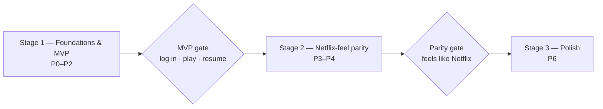
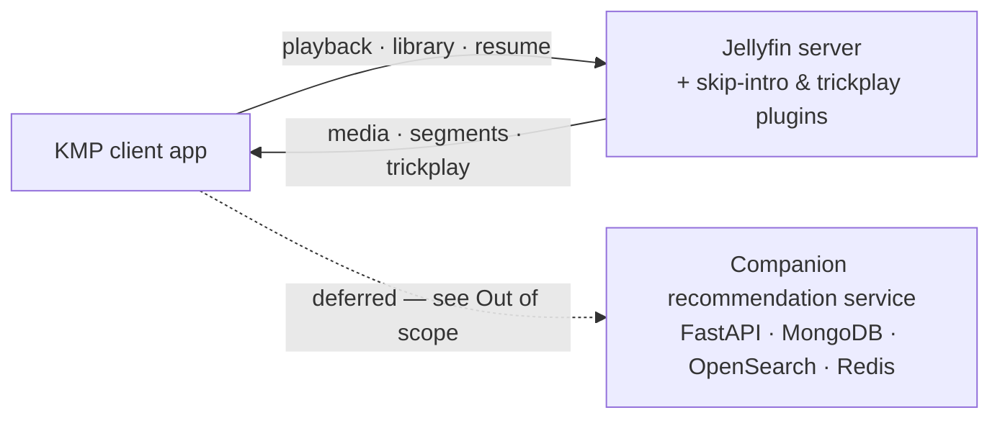

# Jellyfin Client — Roadmap

A custom [Jellyfin](https://jellyfin.org) client aiming for Netflix-grade core UX.
Modern Jellyfin (10.10+) already provides the player and playback machinery; this
roadmap builds a polished client on top of it.

**Guiding principle:** everything mechanical (resume, next up, skip-intro, trickplay,
subtitles, HDR) is server-provided or a thin client layer. The hard, unique work —
personalized discovery — is intentionally **out of scope for now** (see the bottom).
The account model differs too: Jellyfin has users, not profiles under one account, so
we approximate rather than fight it.

## Stack

- **Kotlin Multiplatform** — shared core in `commonMain` (API client, playback beacon,
  state, offline cache); native UI per platform (or Compose Multiplatform).
- **API layer** — Ktor + kotlinx.serialization in `commonMain`. The official
  [`jellyfin-sdk-kotlin`](https://github.com/jellyfin/jellyfin-sdk-kotlin) is
  JVM/Android-only and [not yet KMP](https://github.com/jellyfin/jellyfin-sdk-kotlin/issues/208),
  so the client is written against the OpenAPI spec at `api.jellyfin.org`.
- **Player** — no shared player; behind `expect`/`actual`: Media3/ExoPlayer
  (Android/TV), AVPlayer (iOS/tvOS), VLCJ (desktop).
- **Suggested** — Koin (DI) and SQLDelight (offline/resume cache), both KMP-native.

## Server prerequisites

- **Jellyfin 10.10+** — required for Media Segments and fast Trickplay (10.11 is fine).
- **Plugins** — Intro Skipper or the official Chapter Segments Provider (Jellyfin won't
  detect segments itself); Trickplay enabled per library.

## Milestones

**MVP = Phases 0–2:** log in, browse, play, resume across devices — a usable client on
its own. Treat it as a real release before layering parity and polish.

## Architecture

## Phases

### Phase 0 — Foundations
- [x] Auth: username/password or Quick Connect; store token + stable device id / client name
- [x] Server version & capability check on connect (warn or degrade below 10.10) — _decided: a
  server below 10.10 is rejected, not warned about_
- [x] API client in `commonMain` (base URL, token, retries, error handling)

_Exit: log in, list libraries, fetch an item's metadata._

### Phase 1 — Core playback
- [ ] PlaybackInfo negotiation with a device profile (direct play vs HLS transcode)
- [ ] Player behind `expect`/`actual` (Media3 / AVPlayer / VLCJ); direct play + transcode fallback
- [ ] Progress beacon: `POST /Sessions/Playing`, `/Sessions/Playing/Progress` (~10s + pause/seek), `/Sessions/Playing/Stopped` — fire `Stopped` reliably on backgrounding and crash
- [ ] Audio & subtitle track selection from `MediaStreams`

_Exit: play a movie and an episode, direct and transcoded, with position reported._

### Phase 2 — Watch status & continuity
- [ ] Continue Watching: `GET /Users/{id}/Items/Resume`
- [ ] Next Up: `GET /Shows/NextUp`
- [ ] Resume on open (seek to `PlaybackPositionTicks`, 10,000,000 ticks/sec)
- [ ] Auto-advance with countdown into Next Up
- [ ] Mark played/unplayed: `POST` / `DELETE /Users/{id}/PlayedItems/{id}`

_Exit: finish an episode on one device, resume on another._

### Phase 3 — Player polish
- [ ] Skip Intro / Credits via Media Segments (all types; skip + ask-to-skip)
- [ ] Trickplay scrub-preview thumbnails
- [ ] HDR / Dolby Vision passthrough where the platform supports it
- [ ] Binge UX: auto-play next, "are you still watching?"

_Exit: skip-intro and scrub previews working end to end._

### Phase 4 — Browse & discovery
- [ ] Home rows: Latest, genres, My Media, plus Resume & Next Up
- [ ] Detail page: metadata, cast, `/Items/{id}/Similar`
- [ ] Search: `/Search/Hints`
- [ ] My List (Favorites), thumbs (`UserData.likes`)
- [ ] Tile trailers (`LocalTrailers` / `RemoteTrailers`, content-dependent)

_Exit: browse, search, open a detail page, add to My List._

### Phase 6 — Accounts, offline & polish
- [ ] Profile picker: quick-switch between users, optional PIN (Jellyfin has no sub-profiles)
- [ ] Parental controls / kids mode (per-user rating, blocked tags, access schedules)
- [ ] Offline downloads (no DRM in base Jellyfin)
- [ ] New-episode notifications (Next Up / Latest polling or push)
- [ ] Settings: quality & bandwidth, subtitle styling

## Cross-cutting

- **Performance** — cache composed home-screen rows; load progressively.
- **Resilient states** — loading / empty / offline / error on every screen, especially the player and the beacon.
- **Observability** — propagate a request / correlation id end to end.
- **Testing** — contract tests against the Jellyfin API; integration tests for the beacon lifecycle.

## Out of scope (for now)

### Phase 5 — Intelligence layer _(deferred)_

Personalized "Because you watched" rows, a ranked home screen, and Top 10 / Trending.
Jellyfin only offers genre and similar-item rows, so this is a separate backend effort
rather than an API call: a companion service (FastAPI + MongoDB, OpenSearch for ranking,
Redis for row caching) fed by the playback beacons. To be built or brought in later.
