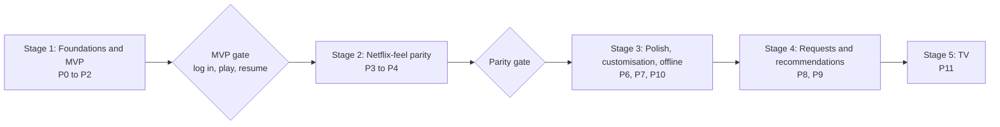
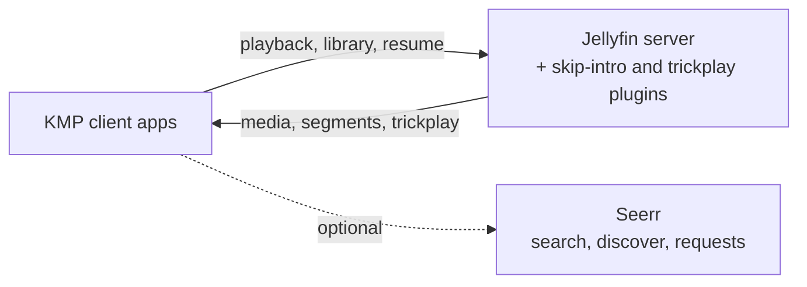

# VibeyFin roadmap

A [Jellyfin](https://jellyfin.org) client with Netflix-grade core UX, native on each platform over a
Kotlin Multiplatform core, with optional [Seerr](https://docs.seerr.dev) requests.

Status as of 2026-11-24. Android ships first. Android is built and run on an emulator against the
local test server; iOS builds and its unit tests pass on the simulator, but most screens have not been
walked through by hand. There has been no real-device pass yet. Detail that used to live here for
finished phases is in the git history and in the closed issues.

**Guiding principle:** everything mechanical (resume, next up, skip intro, trickplay, subtitles, HDR)
is server-provided or a thin client layer. Personalised "Because you watched" rows come from Seerr (Phase 9), not from a backend of our own. Jellyfin has users, not
profiles under one account, so profiles are approximated rather than fought.

## Status at a glance

| Phase | What                                  | State                                              |
|-------|---------------------------------------|----------------------------------------------------|
| 0     | Foundations                           | Done                                               |
| 1     | Core playback                         | Done                                               |
| 2     | Watch status and continuity           | Done                                               |
| 3     | Player polish                         | Done                                               |
| 4     | Browse and discovery                  | Done                                               |
| 6     | Accounts and polish                   | Done, on-device passes owed                        |
| 7     | Customisation                         | In progress                                        |
| 8     | Seerr integration                     | Built, follow-ups open                             |
| 9     | Seerr-based recommendations           | Not started                                        |
| 10    | Offline                               | Done                                               |
| 11    | TV apps (Android TV, Apple TV)        | Planned, issue #123                                |
| —     | Playback engine on iOS                | Done                                               |
| —     | Advanced playback                     | Backlog, gated on demand                           |

## Stack

- **Kotlin Multiplatform**: shared core in `shared/` (API client, playback beacon, state, ViewModels,
  offline); native UI per platform (Jetpack Compose, SwiftUI). See `CLAUDE.md`.
- **API layer**: Ktor and kotlinx.serialization in `commonMain`, written against the OpenAPI spec at
  `api.jellyfin.org`, because the official SDK is JVM/Android-only.
- **Seerr**: optional; the same approach, a thin Ktor client against `seerr-api.yml` (base path `/api/v1`).
- **Player**: no shared player. Media3 ExoPlayer on Android, AVPlayer on iOS with AetherEngine for what
  AVPlayer can't play (`docs/ios-playback.md`).
- **Storage and DI**: Room KMP, DataStore, Koin.

## Server prerequisites

- **Jellyfin 10.10+**, for Media Segments and fast Trickplay (10.11 and 12 work; the test server runs 12).
  A server below 10.10 is rejected, not warned about.
- **Plugins**: Intro Skipper or the official Chapter Segments Provider (Jellyfin does not detect
  segments itself); Trickplay enabled per library.
- **Seerr** _(optional)_: an instance linked to the same Jellyfin server. Every Seerr feature stays
  hidden until one is connected.

## Milestones

## Architecture

## Done phases

### Phase 0: Foundations
Auth by password or Quick Connect, a stable device id, a server version check, and the Ktor API client
(base URL, token, retries, error handling).

### Phase 1: Core playback
PlaybackInfo negotiation with a device profile (direct play, direct stream, HLS transcode); native
players on both platforms; the progress beacon (`Playing`, `Progress` about every 10 s and on pause or
seek, `Stopped` on backgrounding or leaving); audio and subtitle selection; player failures retry a lost
connection twice, ask once more on a 401, and otherwise fall back to one transcode.

### Phase 2: Watch status and continuity
- `Stopped` is sent after a crash from a pending record in Room (kept 24 h, sent as the profile that started it).
- Continue watching is one row that also holds Next up.
- Resume uses the server's position as the only source of truth; a local position is only the offline fallback.
- Auto-advance into Next up with a countdown (on by default). Mark played and unplayed.
- User-data writes are optimistic and revert with a message on failure. Only setting played or a
  favourite is retried; every other write is never repeated.

### Phase 3: Player polish
Stats overlay (off by default), skip intro and credits from Media Segments, trickplay previews, HDR
and Dolby Vision passthrough, "Are you still watching?", playback speed, picture-in-picture, HDR and
format badges, and summed skips and double-tap seek.
- _Decided_: no in-app mini player on either platform; PiP is a per-profile setting, on by default.
- Real HDR output is unverified (neither simulator reports an HDR display).
- Since then: the screen dims and may turn off after a long pause (#94), and the player has YouTube-style
  seeking with previous and next episode (#108).

### Phase 4: Browse and discovery
Main navigation (Home, Search, Library, Downloads, each with its own back stack); Home rows (hero,
Continue watching, Latest per library, My List, genres, My media) and category buttons (Shows, Movies,
New, Categories); detail pages for movies, series, collections and people, with cast, similar titles,
extras and trailers; unified search with filters and per-profile history; Library browse with
combinable filters (`FilterSet`, #23); My List; poster long-press menu.
- _Decided_: thumbs were cut; My List covers "I want this". The shared-element transition is built but off by default.
- Android is built and run; iOS compiles and its unit tests pass, but the screens are not walked through by hand.

### Phase 6: Accounts and polish
Profile picker with an optional 4-digit household PIN (not security); kids mode (a local flag that
shows the server's parental limits read-only, the server enforces them); new-episode and new-movie
notifications (off by default; WorkManager on Android, `BGAppRefreshTask` on iOS); Settings (quality
cap, subtitle style, skipping and autoplay, PiP, tablet two-pane); profile page with Switch profile
and Sign out.
- _Decided_: the iOS mini player was dropped.
- **Baseline profile**: generated and committed on 2026-11-01 (`androidApp/src/main/generated/baselineProfiles/baseline-prof.txt`, with R8 on for release). The `:benchmark` module regenerates it (`./gradlew :androidApp:generateBaselineProfile`, needs a device signed in on the test server). `StartupBenchmark` has never been run and no numbers are recorded.
- The `benchmark` build type (`./gradlew :androidApp:installBenchmark`) is the build to judge smoothness with, because the debug build is slow.
- **Debug and release are told apart** (2026-11-24): debug builds are `app.vibeyfin.debug` on both platforms and install next to release (`app.vibeyfin`); the app name is the same and a Debug label on the icon tells them apart.

- **System integration**: iOS has Now Playing in Control Center and on the lock screen (remote commands, live card, artwork) and PiP; Android has a `MediaSession` with a media notification and PiP. Background playback is out of scope.
- Owed: a phone pass on real devices (the simulators have no PiP and no HDR display).

### Phase 8: Seerr integration
Built from shared code and checked against the test server's Seerr; Android built, iOS compiled and
unit-tested only; no device pass yet.
- _Decided_: one Seerr address per Jellyfin server, a session per profile, silent Quick Connect sign-in (the app approves the code itself with the profile's token), and only the `connect.sid` cookie is kept, sealed in the token vault. Kids profiles get no Seerr. Status is shown in `ink` with an icon, never copper.
- Built: connect (Settings, Requests, Seerr), "Not in your library" search group, discover rows on Home (Trending, Popular movies, Popular shows, Coming soon), title pages for titles not in the library, requests with a season picker and 4K, cancel, My requests, opening the Jellyfin item for titles Seerr says are available, local failure states. Collection and studio pages (#97, #98) are closed.
- Open follow-ups: person page (#99), collection and studio on the title page (#96), request from an episode and request the remaining seasons of a partly requested show (#95). Admin actions, issues and the Seerr watchlist are left for later.

### Phase 10: Offline
Download an item's original file (movie, episode, season or show, per profile), offline playback through
the same native players, offline progress synced through the same pending-record table as Phase 2,
storage management, and offline states (the app opens on what is downloaded when the server is
unreachable, or Offline mode can be switched on). Download progress shows outside the app on iOS (#31).
Android is run on the emulator and iOS builds with its tests passing.
- Open question: quality selection for downloads. Jellyfin has no offline transcode as far as we know, so it only goes in if the OpenAPI spec shows a way.

### Playback engine on iOS
AVPlayer first, AetherEngine for what it can't play, chosen per title by the shared model; PGS subtitles
painted by the app; the item screen says how a title will play. The PoC is finished, VLCKit was dropped
(#26), and playback performs well. Behaviour and limits are in `docs/ios-playback.md`.

## In progress

### Phase 7: Customisation
Make the app the user's own: Home rows, card and hero looks, theme and player behaviour are settings,
kept per profile, and the designed experience stays the default (umbrella issue #16).

Built so far:
- Per-profile settings and the Settings screens (Phase 6), one definition per profile setting (#65).
- Themes: the mechanism (#15): a profile's `themeId` picks an entry of the `themes` list in `design/tokens.json`, and colours are generated from it. Only the default theme exists so far. _Decided_: dark only, white the only action colour, copper the only state colour; no light theme, dynamic colour or free colour picker.
- Home hero as a carousel of 1 to 5 titles, or off (#17); a Home setting to leave watched titles out of rows (#83); default audio and subtitle language (#28); skeleton shimmer follows Reduce Motion (#80); a language setting with translations through Weblate (#27).

Still to do:
- [ ] More themes (an AMOLED theme and user-made themes), as entries in `design/tokens.json`.
- [ ] Custom Home rows: reorder, hide and rename any row, and user-defined rows saved from filter combinations (#24), with a live preview editor.
- [ ] Row and card layout per row (artwork type, size, item count, "See all" density, shown badges); hero source and height.
- [ ] Navigation: choose and order the tabs, set the start tab, hide libraries.
- [ ] Player preferences still missing: auto-advance off. Swipe gestures and the skip steps are already settings.
- [ ] Settings that travel: copy from another profile, export and import. **Open question:** also sync through Jellyfin's per-client `DisplayPreferences`, or keep everything on the device.
- [ ] Reconcile `docs/design/guardrails.md` (row order, 12-row cap, one-badge rule and "no rotating hero" become defaults rather than limits; decide which stay hard).
- [ ] Every setting holds up under font scale, contrast and screen readers, and hiding every row still leaves a usable Home.

_Exit: reorder and hide Home rows, add a row from a genre, change how its cards look, see one setting differ between two profiles, and reset it all to the defaults._

## Planned

### Phase 9: Seerr-based recommendations
"Because you watched" rows without a backend of our own. _Depends on Phase 2 and Phase 8._
- [ ] Seeds from recent finished titles, mapped to TMDB ids through `ProviderIds`.
- [ ] "Because you watched" rows from `/movie/{id}/recommendations` and `/tv/{id}/recommendations`, topped up with `/similar`; no repeats, nothing already watched or requested.
- [ ] Every recommendation is one tap from an action: it plays or opens in Jellyfin, or can be requested.
- [ ] Trending and genre rows from `/discover/...`, and the user's Seerr watchlist.
- [ ] "Not interested": **open question** whether Seerr's blocklist works (it may need extra permissions) or it stays on the device.
- [ ] Cache the composed rows and refresh in the background.

### Phase 11: TV apps (Android TV, Apple TV)
Level 1 is issue #123 (umbrella #18). The earlier per-screen TV issues (#113 to #122) are closed. A household signs in with the phone (Quick Connect), picks a profile, browses and plays a title on both platforms at once.
- [ ] Android TV module (mobile/TV split, shared Android design module, Compose for TV; needs approval before the dependency is added).
- [ ] Apple TV setup: Apple targets added to `shared` with `iosMain` code moved to `appleMain`, a shared Swift package for the engines, theme and helpers, and a separate `tvosApp` target.
- [ ] A `tv` strings layer with remote-friendly wording (after #111, which is done).
- [ ] Core loop on both: connect and sign in, Who's watching, Home and detail pages, and the player.
- Out of scope for level 1: skip intro, Up next, trickplay, frame-rate and HDR matching, passthrough, version picker, Top Shelf and Watch Next (#41), voice search, Live TV, music, downloads, PiP and notifications.
- Designs come from the TV mockups in the VibeyFin design system artifact and must exist before work starts.

## Open work from GitHub issues

| Issue | What                                                               | Phase / area       |
|-------|--------------------------------------------------------------------|--------------------|
| #142  | Trickplay scrub preview squashed, small and slow (all platforms)   | Player (bug)       |
| #131  | Series detail: Play says S1 E0 while Specials is selected          | Browse (bug)       |
| #130  | Search: People results oversized and misaligned                    | Browse (bug)       |
| #123  | TV apps, level 1                                                   | Phase 11           |
| #99   | Seerr: actor page                                                  | Phase 8 follow-up  |
| #96   | Seerr: collection and studio on the title page                     | Phase 8 follow-up  |
| #95   | Seerr: request from an episode, request remaining seasons          | Phase 8 follow-up  |
| #50   | Pre-release: screenshots, promo images, README cleanup, Reddit post| Release            |
| #48   | Cast to Chromecast and Google TV                                   | Backlog            |
| #41   | Google TV: Continue watching row integration                       | Phase 11 later     |
| #24   | Custom user rows from saved filters                                | Phase 7            |
| #22   | Separate admin app for Jellyfin administrators                     | Backlog            |
| #21   | iOS performance check                                              | Quality            |
| #18   | TV apps umbrella                                                   | Phase 11           |
| #16   | Customisation umbrella                                             | Phase 7            |

## Backlog: advanced playback _(gated on demand)_

Not scheduled. Each item waits for real demand, and its limit is written down so it isn't promised by accident.
- [ ] Subtitle delay: neither Media3 nor AVPlayer has a built-in setting, so it means custom rendering; a subtitle burned into the picture (every subtitle on iOS today) can't be delayed.
- [ ] Audio delay: the same, no built-in setting in either player.
- [ ] Decoder selection: Android only (`MediaCodecSelector`); iOS has no equivalent.
- [ ] Software-decode fallback: a heavy dependency (and licence), and the server's transcode already covers the case.

## Cross-cutting

- **Performance**: cache composed Home rows and load progressively. Android Home load order was checked in #20; the iOS check is #21.
- **Five states**: every screen has loading, empty, offline, error and locked states, with copy in `Strings` and `LoadMessages`. Loading is a skeleton, not a spinner (spinners only for an action in progress and in the player). Part of every phase's definition of done.
- **Optimistic writes**: see Phase 2.
- **Seerr is optional**: no Seerr screen, row or setting appears until one is connected, and a Seerr failure only affects its own rows.
- **Observability**: propagate a request or correlation id end to end.
- **Testing**: contract tests against the Jellyfin API and integration tests for the beacon lifecycle; every feature runs against the test server (`docs/test-server.md`) and adds the fixtures it needs.
